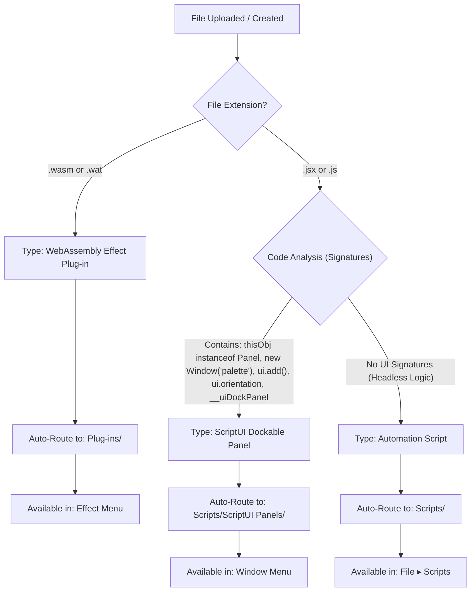

# EffectCraft Mobile & Desktop Extensions & Plug-ins Guide

This comprehensive guide covers everything you need to know about extending EffectCraft on both mobile (Android) and desktop: how the extension system is architected, how the folder hierarchy works, how in-app smart auto-detection functions, full API references, and **how to generate working extensions using AI (ChatGPT, Claude, Gemini)**.

---

## Table of Contents
1. [Overview & Architecture](#1-overview--architecture)
2. [Extension Types & Folder Locations](#2-extension-types--folder-locations)
3. [Mobile In-App Uploader & Smart Auto-Detection](#3-mobile-in-app-uploader--smart-auto-detection)
4. [ExtendScript & ScriptUI Reference](#4-extendscript--scriptui-reference)
5. [Step-by-Step: Creating a Dockable ScriptUI Panel](#5-step-by-step-creating-a-dockable-scriptui-panel)
6. [WebAssembly Effect Plug-ins](#6-webassembly-effect-plug-ins)
7. [Generating Extensions with AI (Prompt Engineering Guide)](#7-generating-extensions-with-ai-prompt-engineering-guide)
8. [Example AI Prompts & Ready-to-Use Tools](#8-example-ai-prompts--ready-to-use-tools)

---

## 1. Overview & Architecture

EffectCraft is engineered for strict After Effects parity. In After Effects and EffectCraft, extensions fall into three distinct categories:

1. **ScriptUI Panels**: Dockable UI tools with buttons, sliders, text inputs, and palettes. They dock into the workspace just like native panels (Composition, Timeline, Render Queue) and appear in the **Window** menu.
2. **Automation Scripts**: Headless or modal ExtendScript (`.jsx` / `.js`) files that automate repetitive tasks (e.g. batch renaming, cleanups, render setups) and appear in the **File ▸ Scripts** menu.
3. **Effect Plug-ins**: Native WebAssembly modules (`.wasm`) that execute high-performance pixel shader math directly on image buffers, appearing in the **Effect** menu and **Effects & Presets** panel.

On mobile devices, user access to hidden internal root directories is restricted. EffectCraft Mobile solves this with an **in-app Extensions & Plug-ins Manager** featuring **intelligent auto-detection**—analyzing code structure and placing files into their exact required runtime folders automatically.

```
┌─────────────────────────────────────────────────────────────┐
│                 EffectCraft Mobile App                      │
├──────────────────────────────┬──────────────────────────────┤
│    JavaScript / ScriptUI     │    WebAssembly FX Engine     │
│  (ExtendScript Object Model) │    (wasm-bindgen / wasmi)    │
├──────────────────────────────┼──────────────────────────────┤
│  📁 Scripts/ScriptUI Panels/ │  📁 Plug-ins/                │
│  📁 Scripts/                 │                              │
├──────────────────────────────┴──────────────────────────────┤
│           Persistent Storage (OPFS & IndexedDB)             │
│            Keys: config/Scripts/..., config/Plug-ins/...    │
└─────────────────────────────────────────────────────────────┘
```

---

## 2. Extension Types & Folder Locations

| Extension Type | File Type | Target Folder | Where It Appears In-App |
|---|---|---|---|
| **ScriptUI Panel** | `.jsx`, `.js` | `Scripts/ScriptUI Panels/` | **Window** menu (docks into workspace) |
| **Automation Script** | `.jsx`, `.js` | `Scripts/` | **File ▸ Scripts** menu |
| **Startup Script** | `.jsx`, `.js` | `Scripts/Startup/` | Runs automatically when app launches |
| **Shutdown Script** | `.jsx`, `.js` | `Scripts/Shutdown/` | Runs when app closes |
| **Effect Plug-in** | `.wasm`, `.wat` | `Plug-ins/` | **Effect** menu & Effects panel |

### Desktop vs. Mobile Storage

- **Desktop (macOS / Windows / Linux)**:
  - macOS: `~/Library/Application Support/EffectCraft/`
  - Windows: `%APPDATA%\EffectCraft\`
  - Linux: `~/.config/effectcraft/`
- **Mobile (Android WebView)**:
  - Stored inside persistent browser storage (Origin Private File System `OPFS` and IndexedDB database `effectcraft`, object store `entries`).
  - Saved under keys prefixed with `config/`:
    - `config/Scripts/ScriptUI Panels/<Name>.jsx`
    - `config/Scripts/<Name>.jsx`
    - `config/Plug-ins/<Name>.wasm`
  - Because mobile files are saved in this virtual sandboxed file system, **you do not need a computer or USB file transfer**; the in-app manager handles everything.

---

## 3. Mobile In-App Uploader & Smart Auto-Detection

The mobile interface provides a floating **🧩 Extensions** button and a top-bar **🧩** icon. Opening it gives access to 4 tabs:

1. **📦 Installed**: View, run, or delete currently active extensions and panels.
2. **⬆️ Upload & Auto-Detect**: Upload any `.jsx`, `.js`, `.wasm`, or `.wat` file.
3. **✏️ Code Creator**: Paste or write ExtendScript directly on your phone with instant starter templates.
4. **📖 AI Prompting Guide**: One-tap copyable prompts to generate custom tools with AI.

### How Smart Auto-Detection Works

When a file is uploaded or created, the app scans the file extension and contents:



Dual persistence ensures the file is both sent to the live engine in-memory file table (`addFile` + `file.installScriptUIPanel`) and written to IndexedDB/OPFS, keeping it permanently active across app restarts.

---

## 4. ExtendScript & ScriptUI Reference

EffectCraft implements After Effects' official DOM. Below are the core objects and methods available in your scripts:

### Project & Composition Hierarchy
```javascript
// Active Composition
var comp = app.project.activeItem;
if (!(comp instanceof CompItem)) {
  alert("Please select a composition first.");
}

// Composition Properties
var width = comp.width;        // e.g. 1920
var height = comp.height;      // e.g. 1080
var duration = comp.duration;  // in seconds
var fps = comp.frameRate;      // e.g. 30
var curTime = comp.time;       // current playhead time in seconds

// Selected Layers & All Layers
var selectedLayers = comp.selectedLayers; // Array of selected Layer objects
var numLayers = comp.numLayers;           // Total layer count
var layer1 = comp.layer(1);               // 1-indexed access
```

### Layer & Transform Properties
```javascript
var layer = comp.selectedLayers[0];

// Basic Attributes
layer.name = "My Hero Title";
layer.inPoint = 0.5;   // start time in seconds
layer.outPoint = 5.0;  // end time in seconds
layer.enabled = true;  // visibility toggle
layer.label = 1;       // label color index (1=Red, 2=Yellow, etc.)

// Transform Properties
var pos = layer.transform.position;
var scale = layer.transform.scale;
var rot = layer.transform.rotation;
var opacity = layer.transform.opacity;

// Getting & Setting Values
var curPos = pos.value; // [x, y, z]
pos.setValue([curPos[0] + 50, curPos[1] + 50]);

// Keyframes
pos.setValueAtTime(0.0, [960, 540]);
pos.setValueAtTime(1.0, [1200, 540]);
```

### Keyframe Easing (`KeyframeEase`)
```javascript
// Temporal ease: speed (units/sec), influence (0 to 100%)
var easeIn = new KeyframeEase(0, 75);
var easeOut = new KeyframeEase(0, 75);

// Apply ease to keyframe index 1
pos.setTemporalEaseAtKey(1, [easeIn], [easeOut]);
```

### Mandatory: Undo Grouping
Always wrap state-modifying actions inside an undo group so the mobile user can easily undo changes with `Ctrl+Z` or the keyboard Undo chiclet:
```javascript
app.beginUndoGroup("Action Name");
try {
  // modify layers, properties, keyframes
} finally {
  app.endUndoGroup();
}
```

---

## 5. Step-by-Step: Creating a Dockable ScriptUI Panel

A dockable ScriptUI panel must handle two environments:
1. When launched from **Window ▸ PanelName.jsx**, `thisObj` is the hosting dockable `Panel`.
2. When launched as a standalone script, `thisObj` is empty, so it falls back to a floating `Window("palette")`.

### Standard Boilerplate Template
```javascript
(function (thisObj) {
  // 1. Dual Host: Dockable Panel or Floating Palette
  var ui = thisObj instanceof Panel ? thisObj : new Window("palette", "Nudge & Align", undefined, { resizeable: true });
  
  // 2. Layout rules
  ui.orientation = "column";
  ui.alignChildren = ["fill", "top"];
  ui.spacing = 6;
  ui.margins = 8;

  // 3. Add UI Elements
  ui.add("statictext", undefined, "Quick Position Shift (px):");
  
  var row = ui.add("group");
  row.orientation = "row";
  row.alignChildren = ["center", "center"];
  row.spacing = 6;

  var btnLeft = row.add("button", undefined, "◀ -20");
  var btnRight = row.add("button", undefined, "+20 ▶");

  var statusText = ui.add("statictext", undefined, "Ready.");

  // 4. Action Logic
  function shiftPosition(dx) {
    var comp = app.project.activeItem;
    if (!(comp instanceof CompItem)) {
      statusText.text = "Open a comp first.";
      return;
    }
    var sel = comp.selectedLayers;
    if (!sel || sel.length === 0) {
      statusText.text = "No layers selected.";
      return;
    }

    app.beginUndoGroup("Shift Position");
    for (var i = 0; i < sel.length; i++) {
      var p = sel[i].transform.position;
      var v = p.value;
      if (p.numKeys === 0) {
        p.setValue([v[0] + dx, v[1]]);
      }
    }
    app.endUndoGroup();
    statusText.text = "Shifted " + sel.length + " layer(s).";
  }

  btnLeft.onClick = function () { shiftPosition(-20); };
  btnRight.onClick = function () { shiftPosition(20); };

  // 5. Finalize Layout & Presentation
  if (ui instanceof Window) {
    ui.show();
  } else {
    ui.layout.layout(true);
  }
})(this);
```

---

## 6. WebAssembly Effect Plug-ins

Effect plug-ins in EffectCraft are compiled WebAssembly modules (`.wasm`) using **API Version 2**.

### Contract & Architecture
- **In-Place RGBA Buffer**: The buffer is premultiplied 32-bit floating point RGBA (`f32`, 0.0 to 1.0).
- **Parameters**: Flattened `f64` array in the order declared in the JSON manifest.
  - Sliders, angles, checkboxes (0/1), and popups use 1 `f64`.
  - Points use 2 `f64` values (buffer coordinates `[x, y]`).
  - Colors use 4 `f64` values (`[r, g, b, a]`).
- **Time**: Layer time in seconds.
- **Determinism**: Calculations must be deterministic and thread-safe.

### Manifest Format (`plugin.json` embedded in wasm custom section or companion):
```json
{
  "api": 2,
  "id": "com.myname.invert-luminance",
  "name": "Invert Luminance",
  "category": "Color Correction",
  "version": "1.0.0",
  "author": "Your Name",
  "description": "Inverts RGB channels while preserving alpha.",
  "params": [
    {
      "type": "slider",
      "id": "amount",
      "name": "Amount",
      "default": 1.0,
      "min": 0.0,
      "max": 1.0
    }
  ]
}
```

---

## 7. Generating Extensions with AI (Prompt Engineering Guide)

Large Language Models (ChatGPT-4o, Claude 3.5 Sonnet, Gemini 1.5 Pro) are capable of writing complete, bug-free EffectCraft extensions if provided with proper system instructions and boundary rules.

### Why Standard AI Prompts Fail Without Constraints
1. **Wrong Language**: AI often hallucinates modern browser JavaScript (`document.createElement`, `window.addEventListener`, `fetch`) instead of Adobe ExtendScript and ScriptUI.
2. **Missing Panel Wrapper**: AI creates standalone scripts that cannot dock into the mobile interface.
3. **No Undo Safety**: AI forgets `app.beginUndoGroup()`, corrupting undo history.
4. **Desktop Assumption**: AI builds wide, multi-column desktop layouts that overflow mobile screens.

### The Master System Prompt for AI Models

Copy and paste this master system prompt into Claude, ChatGPT, or Gemini before asking for a tool:

```text
You are an expert After Effects and EffectCraft ExtendScript developer.
Your task is to write a dockable ScriptUI Panel extension for EffectCraft that works smoothly on mobile touchscreens and desktop.

CRITICAL RULES AND CONSTRAINTS:
1. EXTENDSCRIPT ONLY: Write valid ExtendScript (ECMAScript 3/5). Do NOT use browser APIs (no document, no window DOM, no HTML/CSS, no fetch).
2. DOCKABLE PANEL BOILERPLATE: Always wrap the entire script in:
   (function (thisObj) {
     var ui = thisObj instanceof Panel ? thisObj : new Window("palette", "Panel Title", undefined, { resizeable: true });
     ui.orientation = "column";
     ui.alignChildren = ["fill", "top"];
     ui.spacing = 6;
     ui.margins = 8;
     
     // [Controls & Handlers here]

     if (ui instanceof Window) ui.show(); else ui.layout.layout(true);
   })(this);
3. MOBILE TOUCH DESIGN: Keep controls compact, single-column or tight horizontal groups. Use large, easy-to-tap buttons.
4. AFTER EFFECTS DOM:
   - Check active comp: `var comp = app.project.activeItem; if (!(comp instanceof CompItem)) return;`
   - Iterate selected layers: `var sel = comp.selectedLayers;`
   - Read/write transform: `layer.transform.position`, `scale`, `rotation`, `opacity`
5. UNDO SAFETY: Always enclose modifications inside `app.beginUndoGroup("Descriptive Name")` and `app.endUndoGroup()`.
6. OUTPUT FORMAT: Output ONLY the raw executable JavaScript/JSX code within a single markdown code block.
```

---

## 8. Example AI Prompts & Ready-to-Use Tools

Here are ready-to-use prompt recipes you can use to generate specialized tools immediately:

### Recipe 1: Layer Stagger / Sequence Panel
**Prompt to AI:**
> "Create a ScriptUI panel called 'Layer Stagger' that takes selected layers and offsets their inPoints sequentially by a user-specified frame offset (default: 5 frames). Include a 'Stagger Forward' and 'Stagger Reverse' button."

### Recipe 2: Quick Keyframe Easer
**Prompt to AI:**
> "Create a ScriptUI panel called 'Fast Ease' with 3 buttons: 'Gentle Ease' (influence 33%), 'Dynamic Ease' (influence 65%), and 'Snap Ease' (influence 85%). When clicked, apply the ease to all selected keyframes on selected layers using `KeyframeEase`."

### Recipe 3: Auto Grid / Layer Arranger
**Prompt to AI:**
> "Create a ScriptUI panel called 'Grid Arranger' that takes selected layers and positions them into a 2D grid in the composition with columns and row spacing inputs."

### Recipe 4: Audio Marker Generator
**Prompt to AI:**
> "Create a ScriptUI panel called 'Beat Tapper' with a large 'Tap Beat' button. Every tap adds a composition marker at the current playback time."

---

## 9. Summary & Quick Action Checklist

1. **Creating tools**: Use AI with the Master System Prompt or write code in the mobile **✏️ Code Creator** tab.
2. **Installing tools**: In the mobile app, tap **🧩 Extensions ▸ Upload & Auto-Detect** and pick your file. The app detects whether it is a ScriptUI Panel, Automation Script, or WASM Plugin, and files it away in the correct directory automatically.
3. **Running tools**:
   - Panels: Open from the **Window** menu or directly from the in-app Extensions list.
   - Scripts: Run from **File ▸ Scripts** or the in-app Extensions list.
   - Plug-ins: Apply from the **Effect** menu onto any layer.
4. **No computer needed**: Everything operates natively on device using high-performance local storage.
