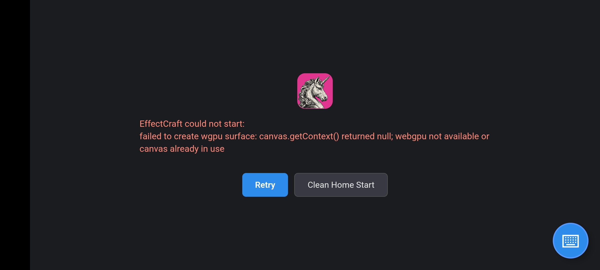
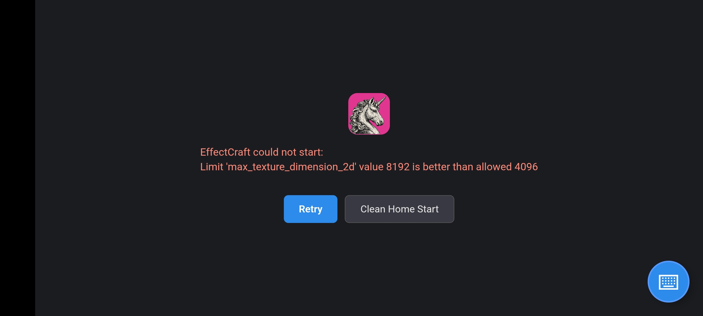

# EffectCraft Pocket

  

  <b>Unofficial Mobile Port for Android</b> 
  <i>Motion graphics, VFX, and visual compositing in your pocket</i>

  
  
  
  

---

## 📱 About EffectCraft Pocket

**EffectCraft Pocket** is an independent, unofficial mobile port of EffectCraft created by **duplexspy**. It brings desktop-class motion graphics and visual compositing directly to Android smartphones and tablets with a fully adapted mobile interface, touchscreen controls, and a custom on-screen laptop keyboard.

---

## ✨ Features Added in the Mobile Port

### ⌨️ Chiclet Virtual Laptop Keyboard
Because mobile devices lack physical keyboards required for motion graphics shortcuts, a custom floating chiclet keyboard was built from scratch:
* **Full Laptop Layout**: Includes `Esc`, top Function keys (`F1`–`F12`), number row, QWERTY keys, `Tab`, `Enter`, and `Backspace`.
* **Dedicated Numpad**: 10-key numeric pad with a `NumLock` toggle and operator keys for precise value and transformation input.
* **Navigation Cluster**: Arrow keys (`Up`, `Down`, `Left`, `Right`), `Insert`, `Delete`, `Home`, `End`, `PageUp`, and `PageDown`.
* **Latching Modifiers**: Sticky toggle support for `Ctrl`, `Alt`, `Shift`, and `Meta/Cmd` to easily trigger complex keyboard combos with one thumb.
* **Quick Macro Bar**: One-tap dedicated action buttons for `Undo` (Ctrl+Z), `Redo` (Ctrl+Y), `Save` (Ctrl+S), `Play/Pause` (Space), and `Fit View` (Shift+/).
* **Floating Draggable Handle**: A discreet floating button that stays on screen, can be dragged anywhere, and toggles the keyboard instantly.

### 📂 Native Android File Chooser & Storage Access
* Seamlessly integrates with the Android system file manager (`ACTION_GET_CONTENT` / `ACTION_OPEN_DOCUMENT`).
* Tap to import footage, video files, audio tracks, and images directly from your device storage, SD card, or Google Drive.
* Project save and open dialogs interact directly with the Android filesystem.

### ⚡ Mobile GPU & Engine Adaptations
* **Dynamic GPU Limit Clamping**: Automatically detects mobile GPU texture limits and clamps `wgpu` `max_texture_dimension_2d` to device capabilities, preventing startup shader and device loss crashes.
* **Automatic WebGL2 Backend**: Routes graphics rendering through a hardware-accelerated WebGL2 surface specifically tuned for Android WebView.
* **Immersive Fullscreen Landscape**: Automatically locks into landscape orientation with sticky immersive fullscreen mode to give you maximum canvas workspace.
* **100% Offline Standalone**: Self-contained package containing all WebAssembly runtime modules, shaders, and fonts. No internet connection needed.

---

## 📸 Screenshots

| Mobile Workspace & Floating Button | Chiclet Virtual Laptop Keyboard |
| :---: | :---: |
|  |  |

| 3D Viewport & Camera | Effects & Compositing Graph |
| :---: | :---: |
|  |  |

---

## 📥 Downloads

Download the latest version from the [Releases](https://github.com/duplexspy/effectscraft-unofficial-mobile-port/releases/latest) section:

* 📱 **[effectcraft-pocket.apk](https://github.com/duplexspy/effectscraft-unofficial-mobile-port/releases/download/v0.6.0-pocket/effectcraft-pocket.apk)**: Standalone installer for Android phones and tablets.
* 📦 **[effectcraft-pocket.aab](https://github.com/duplexspy/effectscraft-unofficial-mobile-port/releases/download/v0.6.0-pocket/effectcraft-pocket.aab)**: Google Play Android App Bundle.

### System Requirements
* **OS**: Android 8.0 (Oreo) or newer
* **Architecture**: ARM64 / AArch64
* **Storage**: ~60 MB free space

---

## 💬 Community & Contact

Have feedback, questions, or ideas for the mobile port?

* **Discord**: Add or message me on Discord at **`@duplexspy`**

---

## 📜 Credits

* **Mobile Port & Virtual Keyboard**: Ported, adapted, and maintained by **duplexspy**.
* **Original Engine**: Desktop engine based on ArtCraft's EffectCraft by Storyteller (`storytold`).
